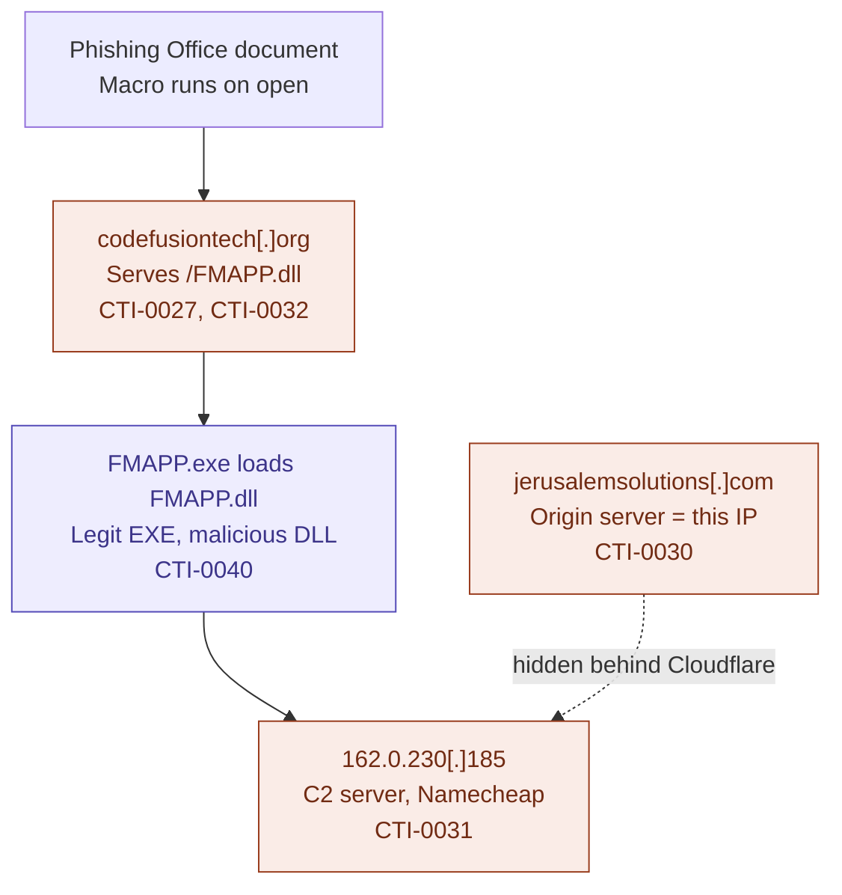

# Threats to Professional Services Firms in Qatar and the GCC
### Cyber Threat Intelligence Assessment — December 2025 to November 2026

**Author:** Olasunkanmi Ogidan  
**Date:** November 2026  
**Classification:** TLP:CLEAR (public sources, sanitised)  
**Framework:** MITRE ATT&CK v19

---

## 1. Executive summary

**Bottom line:** ransomware is the most immediate confirmed threat to professional services firms in Qatar, and an Iranian state espionage campaign with live infrastructure is the most significant assessed threat. Both can be detected with the content delivered in this report.

- **Two ransomware groups have hit the sector in Qatar.** In the last 12 months, **The Gentlemen** claimed a Qatari design consultancy and **Payload** claimed a Qatari law firm. Professional services made up 22% of claimed ransomware victims in Qatar, tied for the most-targeted sector.
- **The ransomware threat has diversified.** Seven groups claimed Qatari victims in the last year, compared with a single group (Qilin) in 2025.
- **The Gentlemen disables security tools before encrypting.** Its EDR killer abuses vulnerable signed Safetica and Lenovo drivers. The driver versions are catalogued in LOLDrivers, but the hashes Acronis reported are new and Microsoft's blocklist coverage is unconfirmed, so hash blocking alone will not stop it and behavioural detection is essential.
- **MuddyWater's Operation Olalampo is active.** The Iranian state actor's MENA campaign uses new malware (CHAR, GhostFetch, HTTP_VIP) and DLL sideloading through a legitimate audio binary. **Two of its C2 domains were still live on 22 November 2026**, and this assessment linked its domains, malware and C2 server into a single verified chain.
- **Detection content is ready for the SOC.** 72 indicators tiered by confidence, 20 validated Sigma rules with Microsoft Defender KQL equivalents, a custom YARA rule and a STIX 2.1 bundle. 25 unique ATT&CK v19 techniques were mapped across the three actors (30 actor-technique pairs), and 19 of those pairs are covered by the delivered rules.

**Priority actions**

1. Block the active MuddyWater domains and the validated malware hashes in Microsoft Defender.
2. Enable the high-fidelity host-artefact rules (Section 8.2, Priority 1).
3. Turn on the attack surface reduction rules for vulnerable signed drivers and Office child processes, and block macros in files from the internet.
4. Restrict remote-access tools such as AnyDesk and protect backups against deletion.

---

## 2. Scope and intelligence requirements

### 2.1 Context

This assessment was produced for a professional services firm in Qatar. Its purpose was to identify the threat actors most likely to target the organisation, collect and validate their indicators of compromise (IOCs), and hand detection content to the Security Operations Centre (SOC).

For this report, *professional services* means legal, consulting, accounting, design and engineering, and IT services firms.

### 2.2 Priority Intelligence Requirements (PIRs)

The work answers three PIRs, each bound to a fixed time window so that it can be measured:

| PIR | Question |
|---|---|
| **PIR 1** | Which threat actors have targeted professional services organisations in Qatar or the wider GCC between December 2025 and November 2026? |
| **PIR 2** | What network infrastructure (domains, IPs, C2 channels, hosting patterns) have those actors used in that window, and is it still active? |
| **PIR 3** | What malware and tools are they deploying, and which MITRE ATT&CK techniques do they use? |

### 2.3 Environment and scope

- **Endpoints:** Windows only. Indicators and detections for Linux, VMware ESXi and NAS devices were researched and then excluded from the deliverable.
- **Security stack:** Microsoft Defender XDR and Microsoft Sentinel. Detection content is delivered as vendor-neutral Sigma rules with KQL equivalents for Defender Advanced Hunting.
- **Sources:** public, TLP:CLEAR material only — vendor research, AlienVault OTX, SOCRadar, VirusTotal, MalwareBazaar and LOLDrivers. No internal telemetry is used or disclosed.

### 2.4 Actors selected for deep analysis

Three actors were taken forward for full IOC collection, validation and detection engineering:

| Actor | Motivation | Why it was selected |
|---|---|---|
| **Payload** ransomware | Financial | Claimed a Qatari law firm as a victim during the review window |
| **The Gentlemen** ransomware | Financial | Claimed a Qatari design consultancy as a victim during the review window |
| **MuddyWater** (Operation Olalampo) | State espionage (Iran) | Active MENA-wide campaign from January 2026, with infrastructure still live in November 2026 |

Selecting one espionage actor alongside two ransomware groups gives detection coverage across both of the motivations most likely to affect the organisation.

---

## 3. Threat landscape (PIR 1)

The findings are split into two tiers. **Confirmed** threats have been observed hitting Qatari professional services firms. **Assessed** threats are actors whose reported targeting of the region or sector makes them a credible risk, but for whom no Qatari professional services victim has been publicly confirmed.

### 3.1 Tier 1 — Confirmed: ransomware

Ransomware leak-site data for Qatar over the last 12 months (SOCRadar Ransomware Intelligence, captured November 2026) shows:

- **9 claimed victims** across **7 groups**: Qilin (2), The Gentlemen (2), Crypto24, Everest, Krybit, NON and Payload (1 each).
- **Professional services accounted for 2 of 9 victims (22%)**, tied with energy and utilities as the most-targeted sector.
  - A Qatari **design consultancy**, claimed by **The Gentlemen** (approximately May 2026).
  - A Qatari **law firm**, claimed by **Payload** (approximately April 2026).

Cyble's September 2026 reporting independently confirms The Gentlemen, Everest, Crypto24 and Payload operating against Qatar in 2026.

**Key judgement:** the ransomware threat to Qatar has **diversified sharply**. Cyble's 2025 assessment found Qilin responsible for 100% of observed ransomware attacks in Qatar; in the last 12 months, seven groups have claimed victims.

**Caveats.** These figures are claims from the groups' own leak sites, not confirmed incidents. Victims who paid quietly do not appear, so the true number is likely higher. Sector labels are assigned by the data platform and were checked manually. Victim organisations are deliberately not named in this report.

### 3.2 Tier 2 — Assessed: other actor types

| Motivation | Actor | Evidence | Confidence |
|---|---|---|---|
| State espionage | **MuddyWater** (Iran, MOIS) | Operation Olalampo targeted organisations primarily across MENA from January 2026 (Group-IB); a related Q1 2026 campaign hit nine organisations in nine countries (Symantec/Carbon Black). Analysed in depth in this report. | **High** that it targets the region; **moderate** for the sector |
| State espionage | **Spectral Kitten** (Iran) | Attempted to infiltrate logistics and professional services organisations in the Middle East (CrowdStrike 2026 Threat Hunting Report, via AGBI). Regional targets not named. | **Moderate / low** — single vendor |
| State espionage | **Camaro Dragon** and other China-nexus actors | Conflict-themed phishing against Qatari entities in March 2026, delivering PlugX and Cobalt Strike (Check Point Research). | **Moderate** — Qatar-specific, sector not stated |
| Initial access brokers | Unnamed brokers | Corporate access to a large Qatari organisation advertised for US$4,900 (CYFIRMA); brokers targeting Qatar's financial sector (Cyble). Access sales commonly precede ransomware. | **Moderate** |
| Hacktivist | Iran-aligned groups (e.g. Fatimion Cyber Team) | DDoS attacks on Qatari targets including an oil firm and a radio station (SecurityWeek); Qatar among the ten most-affected regions for DDoS claims (Intel 471). Activity against Qatar has since declined (The National). | **Low** — disruptive, not data-focused |
| Insider / fraud | **Famous Chollima** (DPRK) | Uses fraudulent identities to obtain remote IT jobs; reported targeting technology, financial and professional services organisations in the region (CrowdStrike, via AGBI). | **Low** — single vendor, Qatar not named |

**Evidence gap.** Public reporting rarely names "professional services in Qatar" specifically. Where sector-specific Qatari evidence is missing, GCC-wide and sector-adjacent reporting has been used as a proxy, and confidence lowered accordingly. The Spectral Kitten and Famous Chollima claims rest on a single vendor (CrowdStrike), reached through press coverage of a gated report.

---

## 4. Actor profiles

### 4.1 Payload ransomware

| | |
|---|---|
| **Type** | Ransomware operation, double extortion (encryption plus data-leak threats) |
| **First active** | February 2026 |
| **Code base** | Derived from leaked Babuk source code |
| **Platforms** | Windows; Linux/VMware ESXi variant (out of scope for this report) |
| **Scale** | 91 victims claimed on its leak site by mid-November 2026, 15 in the preceding 30 days (Proven Data) |
| **Regional activity** | Claimed Royal Bahrain Hospital (March 2026); claimed a Qatari law firm (approximately April 2026) |

**How it operates (Windows).** The encryptor relaunches itself with a `--background` argument, deletes Volume Shadow Copies (`vssadmin delete shadows /all /quiet`) so victims cannot restore files, then encrypts data and appends the `.payload` extension. It enforces a single running instance with the mutex `MakeAmericaGreatAgain` and writes an activity log to `C:\payload.log`. Reporting also describes ETW patching, event-log clearing and self-deletion to frustrate investigation.

**Why it matters.** Payload is new, growing fast and already active in the Gulf. Its claim against a Qatari law firm places it squarely within the organisation's peer group.

**What this assessment found.** The Windows sample was validated across three independent sources, and its behaviour in the VirusTotal sandbox matched the vendor advisory (shadow-copy deletion, mutex, log file). No public YARA rule specific to the Windows build existed, so one was written for this project (Section 8).

### 4.2 The Gentlemen ransomware

| | |
|---|---|
| **Type** | Ransomware-as-a-Service (RaaS), double extortion |
| **Tracked as** | Storm-2697 (Microsoft), GOLD SHERWOOD (Sophos) |
| **First active** | Mid-2025; opened to affiliates in September 2025 |
| **Origin** | Russian-speaking; reportedly a former affiliate of LockBit and Qilin (Acronis) |
| **Code base** | Written in Go; targets Windows, Linux, NAS and BSD |
| **Regional activity** | Claimed a Qatari design consultancy (approximately May 2026) |

**How it operates.** The Gentlemen's tradecraft is distinctive and well documented:

- **Disabling security tools first.** Its EDR killer drops a legitimate but vulnerable signed driver — Safetica ProcessMonitorDriver (CVE-2025-70795) or Lenovo BootRepair.sys — installs it as a service, and uses it to terminate security processes from kernel mode ("bring your own vulnerable driver").
- **Persistence and theft.** Affiliates use AnyDesk for remote access and WinSCP for encrypted data exfiltration.
- **Rapid spread.** The encryptor runs as SYSTEM through a scheduled task named `gentlemen_system` and attempts several lateral-movement methods at once; affiliates also push it via Group Policy.
- **Anti-analysis.** Samples only run when given the correct password on the command line, so automated sandboxes see very little.

**Why it matters.** The group is mature, generous to affiliates (up to 90% of ransom revenue) and has already hit a Qatari professional services firm. Its EDR-killing step means endpoint protection alone cannot be relied on.

**What this assessment found.** Two samples were fully validated and 16 corroborated. Vendor labels show the encryptor **evolving during 2026** — from variant ".B" (first seen April 2026) to ".D" (July 2026), with all 16 bulk-checked samples being ".D". The EDR-killer and driver hashes published by Acronis could not be found on VirusTotal. The two drivers themselves are not new: LOLDrivers already lists Safetica STProcessMonitor 11.26.18 (added from ESET's Gentlemen research) and Lenovo BootRepair.sys 2.5.30.11281 — the same versions Acronis reports — but under different hashes. The Acronis copies, named in a `<name>_clone_NN_<hex>.sys` pattern, may be modified copies or different builds; this cannot be confirmed without samples. As far as this assessment found, Acronis is the first public source linking BootRepair.sys to The Gentlemen. Safetica states that Microsoft agreed to add 11.26.18 to its vulnerable-driver blocklist from 15 November 2026, but calls the date indicative; this is not independently confirmed, and BootRepair coverage is unknown. Behavioural detection is therefore the primary control (Section 8). The two new hashes and the Acronis reference were submitted to LOLDrivers (issue #504, pull request #505).

### 4.3 MuddyWater — Operation Olalampo

| | |
|---|---|
| **Type** | State-sponsored espionage |
| **Attribution** | Iran, Ministry of Intelligence and Security (MOIS) |
| **Also known as** | Mango Sandstorm, Seedworm, Static Kitten (MITRE ATT&CK G0069) |
| **Active since** | 2017 |
| **Campaign** | Operation Olalampo, first observed 26 January 2026, targeting organisations primarily across MENA (Group-IB) |

**How it operates.** Olalampo begins with phishing documents themed around a regional energy and marine services company, flight tickets or reports. When the victim enables macros, the macro decodes a payload hidden in a form control, writes it to disk and runs it. Three new malware families were used:

| Malware | Role |
|---|---|
| **CHAR** | Rust backdoor controlled through a Telegram bot. Debug strings containing emojis suggest AI-assisted development. |
| **GhostFetch** | First-stage downloader that checks for sandboxes, persists as `burn.exe`, and loads the **GhostBackDoor** second stage. |
| **HTTP_VIP** | Downloader and backdoor that profiles the host and fetches AnyDesk for remote access. |

Operators also sideloaded a malicious DLL through **FMAPP.exe**, a legitimate signed Fortemedia audio binary, and used the open-source reverse-SOCKS tool **resocks** to tunnel traffic. Symantec/Carbon Black documented the same FMAPP sideloading technique in a parallel Q1 2026 campaign that hit nine organisations in nine countries.

**Why it matters.** MuddyWater has a long record of espionage across the Middle East, including Qatar, and Olalampo is its current MENA campaign. Two of its C2 domains were still live in November 2026, so this is an active threat rather than a historical one.

**What this assessment found.** Starting from Group-IB's indicators, the infrastructure and malware were linked end to end through independent evidence: a C2 domain hosting the malicious DLL, the DLL connecting to a C2 IP, and that IP serving as the hidden origin server of another campaign domain (Sections 5–6). Microsoft assigns the same detection name (`Trojan:Win64/MuddyWater.DA!MTB`) to three of the four validated files, and Trend Micro names the HTTP_VIP family directly.

---

## 5. Infrastructure (PIR 2)

### 5.1 MuddyWater command-and-control

All four Olalampo domains and the IP listed by Group-IB were validated against VirusTotal and AlienVault OTX. Their current status differs, which changes how the SOC should use them.

| ID | Indicator | Role | Status (Nov 2026) | SOC use |
|---|---|---|---|---|
| CTI-0027 | `codefusiontech[.]org` | HTTP_VIP C2; hosted the malicious FMAPP.dll | **Active** — certificate renewed Oct 2026, resolving | Block, hunt |
| CTI-0028 | `promoverse[.]org` | GhostFetch C2 | **Active** — certificate renewed Oct 2026; domain expires 21 Dec 2026 | Block, hunt; review at expiry |
| CTI-0029 | `miniquest[.]org` | HTTP_VIP C2 | **Suspended** — registrar hold, not resolving since 27 Feb 2026 | Retro-hunt Jan–Feb 2026 |
| CTI-0030 | `jerusalemsolutions[.]com` | Campaign infrastructure (OTX: "operation olalampo", "http_vip") | **Expired** 28 Oct 2026, now parked | Retro-hunt Oct 2025 – Oct 2026 |
| CTI-0031 | `162.0.230[.]185` | C2 server for FMAPP.dll; hidden origin of jerusalemsolutions | Namecheap hosting IP, may be reassigned | Short-term block (60 days), hunt |

Six C2 URL paths were also recovered from the relations of validated malware samples. They allow more precise proxy detection than the domains alone:

| ID | URL | Contacted by |
|---|---|---|
| CTI-0032 | `hxxp://codefusiontech[.]org/FMAPP.dll` | Delivery of the sideloaded DLL (OTX) |
| CTI-0033 | `hxxps://codefusiontech[.]org/postinfo` | HTTP_VIP (`pic.log`) |
| CTI-0034 | `hxxps://codefusiontech[.]org/content?id=141` | HTTP_VIP (`pic.log`) |
| CTI-0035 | `hxxps://promoverse[.]org/api/debut` | GhostFetch (`burn.exe`) |
| CTI-0036 | `hxxps://promoverse[.]org/api/authentification/connexion` | GhostFetch sibling build |
| CTI-0037 | `hxxps://promoverse[.]org/api/accueil/etat` | GhostFetch sibling build |

The French-language paths (*authentification/connexion*, *accueil/etat*) are an unusual characteristic of the GhostFetch C2 protocol.

### 5.2 Infrastructure pattern

Every Olalampo domain follows the same pattern:

- registered through **Namecheap** with **privacy-protected WHOIS**;
- **fronted by Cloudflare**, so DNS resolves to shared Cloudflare IPs rather than the real server;
- **staged in advance** — `jerusalemsolutions[.]com` was registered three months and `promoverse[.]org` five weeks before the campaign was first observed;
- **short-lived** in some cases — `miniquest[.]org` operated for about four weeks before suspension.

Because the domains sit behind Cloudflare, **blocking their resolved IPs would be ineffective and harmful**: those IPs are shared by millions of legitimate websites. Domains and URLs are the reliable network indicators.

### 5.3 Attack chain

Independent evidence links a domain, a file and an IP into one chain:

| Link | Evidence |
|---|---|
| Domain → DLL | OTX recorded `hxxp://codefusiontech[.]org/FMAPP.dll` on 17 May 2026 |
| DLL → IP | The validated FMAPP.dll (CTI-0040) contacts `162.0.230[.]185` in VirusTotal |
| IP ↔ domain | TLS certificates for `jerusalemsolutions[.]com` were served from the IP between December 2025 and February 2026 — the IP was the real server behind Cloudflare, which is why it never appeared in the domain's DNS history |

The first step (phishing document → download) reflects Group-IB's description of the campaign; every link from the domain onwards was verified independently in this assessment.

### 5.4 Pivots tested and rejected

Several apparent connections were investigated and ruled out. Recording them prevents false indicators reaching the SOC.

| Apparent link | Why it was rejected |
|---|---|
| ~290 "related domains" on OTX for each C2 domain | Linked only through `abuse@namecheap.com`, the registrar's abuse contact, which appears on every Namecheap domain |
| Matching registrant IDs across the domains | They identify the WHOIS privacy service, not the attacker, and are shared by thousands of domains |
| A shared parking IP on the `www` subdomains | Belongs to a domain-parking service |
| New IPs for `jerusalemsolutions[.]com` after 28 Oct 2026 | Appeared on the day the domain expired; they belong to the parking provider |
| `brendysubs[.]com`, which later used the same server as CTI-0031 | 0/92 detections, different registrar, registered before MuddyWater used the IP — most likely an unrelated tenant |

The last finding also shows that `162.0.230[.]185` may now host legitimate websites, which is why it carries a short review date.

### 5.5 Ransomware infrastructure

Neither ransomware group exposes infrastructure that is useful for blocking. Both run Tor (`.onion`) leak and negotiation sites, which corporate traffic never reaches directly. The Gentlemen also publish a SimpleX chat invite, a TOX ID and an X account; SimpleX is a legitimate public messaging service, so its domain should not be blocked. These items are recorded as context only. For ransomware, **host-based and behavioural indicators** (Sections 6 and 8) carry the defensive value.

---

## 6. Malware and tools (PIR 3)

Every file indicator was assigned a confidence tier:

| Tier | Meaning |
|---|---|
| **Validated** | Fully checked: two or more independent sources, consistent vendor labels and, where possible, matching sandbox behaviour or links to validated infrastructure |
| **Corroborated** | Listed by a primary source and confirmed on VirusTotal with at least one supporting vendor label; bulk-checked rather than examined in depth |
| **Single-source** | Confirmed malicious, but attribution rests on one primary source only |
| **Reported, unverified** | Listed by one source and not found in any public repository |

Full hashes for every indicator are in [`iocs/iocs.csv`](iocs/iocs.csv) and the STIX bundle.

### 6.1 Payload

| ID | Indicator | Type | Confidence |
|---|---|---|---|
| CTI-0001 | `1ca67af9…12ffb71f` — Windows encryptor | SHA-256 | Validated (High) |
| CTI-0002 | `MakeAmericaGreatAgain` | Mutex | Validated (High) |
| CTI-0003 | `C:\payload.log` | File path | Validated (High) |

The sample is confirmed by the vendor advisory, a MalwareBazaar "Payload" signature and the VirusTotal filename `babuk_payload_win`. In the sandbox, the `--background` child process writes `C:\payload.log`, tying the log file, the relaunch behaviour and the mutex together.

### 6.2 The Gentlemen

| ID | Indicator | Type | Confidence |
|---|---|---|---|
| CTI-0004 | `1334f018…2334436f` — encryptor, variant .B | SHA-256 | Validated (High) |
| CTI-0005 | `3c2466d8…622f51f3` — encryptor, variant .D | SHA-256 | Validated (High) |
| CTI-0006 – 0021 | 16 encryptor samples, all variant .D | SHA-256 | Corroborated (Medium-High) |
| CTI-0022 – 0023 | EDR killer | SHA-256 | Reported, unverified (Low) |
| CTI-0024 – 0025 | Vulnerable drivers (Safetica, Lenovo) | SHA-256 | Reported, unverified (Low) |
| CTI-0026 | `gentlemen_system` | Scheduled task | Vendor-reported (Medium) |

Major vendors — Microsoft, ESET, Fortinet, Elastic, Sophos and Trend Micro — label both validated samples as The Gentlemen. A minority labelled CTI-0004 as *BlackByte*; the same vendors labelled the newer CTI-0005 as The Gentlemen, which points to a signature overlap rather than a different group.

### 6.3 MuddyWater

| ID | Indicator | Type | Confidence |
|---|---|---|---|
| CTI-0038 | `8d2227f2…cdf80548b` — GhostFetch (`burn.exe`) | SHA-256 | Validated (High) |
| CTI-0039 | `3a19c19d…947bd819` — GhostFetch sibling build | SHA-256 | Validated (Medium-High attribution) |
| CTI-0040 | `3fa148e2…2e4e68af` — malicious `FMAPP.dll` | SHA-256 | Validated (High) |
| CTI-0041 | `1b9e6fe4…568b0009a` — HTTP_VIP (`pic.log`) | SHA-256 | Validated (High) |
| CTI-0042 – 0056 | 15 Group-IB samples with MuddyWater vendor labels | SHA-1 | Corroborated (Medium-High) |
| CTI-0057 – 0065 | 9 Group-IB samples, malicious but generically labelled (incl. 4 resocks builds) | SHA-1 | Single-source (Medium) |
| CTI-0066 – 0068 | 3 Group-IB samples not found on VirusTotal | SHA-1 | Reported, unverified (Low) |
| CTI-0069 | `%LOCALAPPDATA%\Microsoft\Windows\BurnUtill\burn.exe` | File path | Validated (High) |
| CTI-0070 | `%USERPROFILE%\AppData\SystemApps\` | Folder | Sandbox-observed (Medium) |
| CTI-0071 | `MicrosoftVersionUpdater` | Service name | Vendor-reported (Medium) |
| CTI-0072 | `DailyUpdate` running `novaservice.exe` | Scheduled task | Vendor-reported (Medium) |

Each of the four validated files connects back to validated infrastructure: `burn.exe` and its sibling contact `promoverse[.]org`, `pic.log` contacts `codefusiontech[.]org`, and `FMAPP.dll` contacts `162.0.230[.]185`. The persistence folder `BurnUtill` is misspelt with a double *l*, which no legitimate software uses — a high-fidelity host indicator.

The four `resocks` builds in the single-source tier are an open-source reverse-SOCKS tool used by many actors. Vendors label such shared tools generically, so the absence of a MuddyWater label is expected.

### 6.4 Analytical findings

Validating the samples surfaced several points that affect how far the indicators can be trusted:

- **Shared detection engines inflate vendor counts.** Seven vendors on VirusTotal (BitDefender, ALYac, Arcabit, eScan, GData, Emsisoft and VIPRE) return identical labels because they license BitDefender's engine. They were counted as one opinion, not seven.
- **Conflicting labels were resolved, not ignored.** Automated feed filenames listing many unrelated malware families were disregarded. Microsoft and Symantec label the GhostFetch sibling as *Cobalt Strike*; because only Trend Micro names MuddyWater, its attribution is held at Medium-High and rests on Group-IB's listing, its contact with validated C2 and its build overlap with `burn.exe`.
- **Compile timestamps are forged.** `burn.exe` claims to have been compiled in January 2023, but was built with Visual Studio 2022 version 17.6, which was released in May 2023. Its sibling was compiled on 26 January 2026 — the day Olalampo was first observed — and both share the same time of day, pointing to a common build process.
- **Sandboxes show little for password-gated ransomware.** The Gentlemen samples exit without encrypting unless given the correct password, so behavioural validation was limited and is recorded as such.
- **AI-generated analysis is treated as a lead only.** VirusTotal's automated *Code insights* described custom HTTP headers used by HTTP_VIP (`X-Computer-Name`, `X-Domain-Name`, `X-Antivirus-Name`). These are promising for proxy detection but are recorded as unverified.

### 6.5 Excluded from the indicator set

Some published "indicators" were deliberately left out:

| Item | Reason |
|---|---|
| `FMAPP.exe` | A legitimate signed Fortemedia binary that may exist on company laptops. Blocking its hash could break audio drivers; it is detected by behaviour instead (FMAPP.exe running from an unusual location). |
| `ThisDocument.cls` / `ThisWorkbook.cls` hashes | Macro code extracted from documents, not files that exist on disk, so a hash block would never match. |
| AnyDesk copies | MuddyWater's server pads each copy to change its hash, so these hashes do not recur. AnyDesk is detected by behaviour. |
| Payload Linux/ESXi encryptor | Validated, but outside the Windows-only scope. |

---

## 7. MITRE ATT&CK mapping (v19)

All mappings use **ATT&CK v19** (released 28 April 2026), which retired the Defense Evasion tactic and split it into **Stealth** (TA0005) — hiding while leaving defences intact — and **Defense Impairment** (TA0112) — actively breaking or blinding defences. Techniques formerly under Defense Evasion are assigned accordingly. The *Detection* column names the project rule covering each technique; a dash means the technique is covered only by indicators or hunting (see 7.4).

### 7.1 Payload

| Tactic | Technique | Evidence | Detection |
|---|---|---|---|
| Impact | T1486 Data Encrypted for Impact | Appends `.payload`; writes ransom notes | Sigma `afb482b2`, `a94db554` |
| Impact | T1490 Inhibit System Recovery | `vssadmin delete shadows /all /quiet` | Sigma `c0f2e1db`, `b4214064` |
| Stealth | T1480 Execution Guardrails | Single-instance mutex `MakeAmericaGreatAgain` | YARA `Payload_Ransomware_Windows` |
| Stealth | T1070 Indicator Removal | Event-log clearing and self-deletion (vendor-reported) | — |
| Defense Impairment | T1685 Disable or Modify Tools | ETW patching (vendor-reported; formerly T1562.006) | — |

### 7.2 The Gentlemen

| Tactic | Technique | Evidence | Detection |
|---|---|---|---|
| Defense Impairment | T1685 Disable or Modify Tools | EDR killer terminates security processes | Sigma `e9f35823` |
| Privilege Escalation | T1068 Exploitation for Privilege Escalation | Vulnerable signed drivers (Safetica CVE-2025-70795, Lenovo BootRepair) | Sigma `e9f35823` |
| Execution, Persistence | T1053.005 Scheduled Task | `gentlemen_system` runs the encryptor as SYSTEM | Sigma `a8840838`, `3f0eff16` |
| Execution | T1059.001 PowerShell | Console banner printed via `Write-Host` | Sigma `07a78679` |
| Command and Control | T1219 Remote Access Tools | AnyDesk for persistent access | Sigma `98e30ea3` |
| Exfiltration | T1048 Exfiltration Over Alternative Protocol | WinSCP for encrypted exfiltration | Sigma `98e30ea3` |
| Privilege Escalation | T1484.001 Group Policy Modification | Encryptor deployed through GPO (vendor-reported) | — |
| Impact | T1486 Data Encrypted for Impact | Go-based encryptor, variants .B and .D | File hashes |

ATT&CK v19 also introduced T1687 *Exploitation for Defense Impairment*, which may fit the vulnerable-driver step more precisely than T1068; the project rules use T1068 pending wider adoption of the new technique.

### 7.3 MuddyWater (Operation Olalampo)

| Tactic | Technique | Evidence | Detection |
|---|---|---|---|
| Initial Access | T1566.001 Spearphishing Attachment | Macro-enabled Word and Excel lures | Sigma `788f57a3` |
| Execution | T1204.002 Malicious File | Victim enables macros; payload written and run | Sigma `788f57a3`, `ed62d9cf` |
| Execution | T1059.001 PowerShell | Encoded PowerShell launching FMAPP.exe (vendor-reported) | — |
| Persistence | T1547.001 Registry Run Keys / Startup Folder | `User Shell Folders\Startup` changed; `BurnUtill` persistence path | Sigma `92a18ec6`, `f2d4e540` |
| Persistence | T1053.005 Scheduled Task | `DailyUpdate` task running `novaservice.exe` | Sigma `fb691629` |
| Persistence | T1543.003 Windows Service | `MicrosoftVersionUpdater` service | Sigma `541895e3` |
| Persistence, Privilege Escalation, Stealth | T1574.001 Hijack Execution Flow: DLL | FMAPP.exe sideloads malicious FMAPP.dll (formerly *DLL Side-Loading*, T1574.002) | Sigma `65d75357`, `be390fef` |
| Stealth | T1497.001 System Checks | VirtualBox and BIOS registry checks | — |
| Stealth | T1622 Debugger Evasion | Debugger and sandbox checks in GhostFetch | — |
| Discovery | T1518.001 Security Software Discovery | WMI query for installed antivirus (automated analysis, unverified) | — |
| Discovery | T1087.002 Domain Account | `net group "domain admins"` reconnaissance (vendor-reported) | — |
| Credential Access | T1555.003 Credentials from Web Browsers | `chrome_inject.exe`; ChromElevator in the parallel campaign | File hashes |
| Command and Control | T1071.001 Web Protocols | HTTPS C2 to `codefusiontech[.]org` and `promoverse[.]org` | Sigma `1eddb10d`, `01ce12f7` |
| Command and Control | T1102.002 Bidirectional Communication | CHAR backdoor controlled through a Telegram bot | Sigma `587eb1b0` |
| Command and Control | T1105 Ingress Tool Transfer | FMAPP.dll and AnyDesk downloaded from C2 | Sigma `01ce12f7` |
| Command and Control | T1090 Proxy | `resocks` reverse-SOCKS tunnelling | File hashes |
| Command and Control | T1219 Remote Access Tools | AnyDesk fetched by HTTP_VIP | Sigma `98e30ea3` |

### 7.4 Coverage summary

| Actor | Techniques mapped | Covered by a project rule (Sigma or YARA) |
|---|---|---|
| Payload | 5 | 3 |
| The Gentlemen | 8 | 6 |
| MuddyWater | 17 | 10 |

Five techniques are shared by more than one actor (T1486, T1685, T1053.005, T1059.001 and T1219), so the 30 actor-technique pairs above cover 25 unique techniques.

Techniques without a project rule fall into two groups. Some are only reported by vendors and were not observed in this assessment (log clearing, ETW patching, GPO deployment, domain reconnaissance). Others are generic behaviours that would generate heavy false positives as standalone rules (sandbox checks, debugger evasion, proxy tooling). Both groups rely on the file hashes and on the SOC's existing baseline detections.

An ATT&CK Navigator layer covering all three actors is provided in [`attack/`](attack/).

---

## 8. Detection and recommendations

### 8.1 Detection content delivered

| Content | Count | Location | Validation status |
|---|---|---|---|
| Sigma rules | 20 (Gentlemen 5, Payload 4, MuddyWater 11) | [`detections/sigma/`](detections/sigma/) | Passed `sigma check` with 0 errors and 0 issues, including ATT&CK v19 tag validation |
| KQL queries (Defender XDR / Sentinel) | 3 files covering every Sigma rule, plus IOC sweeps | [`detections/kql/`](detections/kql/) | Converted with pySigma where possible, hand-written otherwise; two queries run successfully in a live Defender tenant, the rest pending |
| YARA rule | 1 (Payload, Windows) | [`detections/yara/`](detections/yara/) | Compiles; logic tested on synthetic data and against benign files; not run against the live sample |
| Indicators | 72 | [`iocs/`](iocs/) | Tiered by confidence (Section 6) |

None of the content has been tested in a lab against live malware. All rules are marked **experimental** and should be tuned in the SOC's environment before alerting at full severity.

### 8.2 Deployment priorities

**Priority 1 — deploy immediately (high fidelity, low false-positive risk)**

- **Block indicators in Defender** (*Settings → Endpoints → Indicators*): all validated and corroborated file hashes, and the active domains and URLs (`codefusiontech[.]org`, `promoverse[.]org` and their C2 paths).
- **Enable the host-artefact rules**, which match names or paths no legitimate software uses:
  - MuddyWater `BurnUtill` persistence path and payload staging paths (Sigma `f2d4e540`, `ed62d9cf`)
  - `MicrosoftVersionUpdater` service (Sigma `541895e3`)
  - `gentlemen_system` scheduled task (Sigma `a8840838`, `3f0eff16`)
  - `C:\payload.log` and Payload ransom notes (Sigma `afb482b2`)
  - FMAPP.exe sideloading from a non-standard path (Sigma `65d75357`, `be390fef`)
  - Safetica or Lenovo vulnerable driver loading (Sigma `e9f35823`)

**Priority 2 — deploy after a short tuning period (behavioural, may need allowlists)**

- Shadow-copy deletion via `vssadmin` (Sigma `c0f2e1db`, `b4214064`)
- Word or Excel launching programs from Public or AppData folders (Sigma `788f57a3`)
- Changes to the per-user Startup folder setting (Sigma `92a18ec6`) — may fire on Group Policy folder redirection
- Non-browser access to the Telegram Bot API (Sigma `587eb1b0`)
- AnyDesk and WinSCP execution (Sigma `98e30ea3`) — add the IT team's approved accounts to the allowlist first
- Execution of programs ending in `.log` (part of Sigma `ed62d9cf`) — watch for noise in the first week

**Priority 3 — hunting and retro-hunting**

- Search historical DNS and proxy logs for `miniquest[.]org` (January–February 2026) and `jerusalemsolutions[.]com` (October 2025 – October 2026).
- Hunt for connections to `162.0.230[.]185`; block it for 60 days, then review.
- Run the hash sweep (KQL `MW-13`) and add the single-source and unverified hashes to watchlists rather than alerting on them alone.

### 8.3 Visibility requirements and gaps

| Detection need | Requirement | Gap or action |
|---|---|---|
| Payload mutex | Mutex creation is not recorded by Defender or Sysmon | Use the YARA rule or live response during an incident |
| MuddyWater C2 URL paths | Full URLs, i.e. a proxy with TLS inspection | Without it, rely on the domain rules |
| Vulnerable driver loading | Defender `DriverLoad` events | Confirm these events are present in the tenant |
| Retro-hunting 2025–early 2026 activity | Log retention beyond Defender Advanced Hunting's 30 days | Use Sentinel if retention allows; otherwise record as a gap |
| Scheduled task creation (any method) | Defender `ScheduledTaskCreated` events, or Windows Event 4698 auditing | Confirm one of the two is available |

### 8.4 Hardening recommendations

1. **Turn on the Defender attack surface reduction (ASR) rules** *Block abuse of exploited vulnerable signed drivers* and *Block all Office applications from creating child processes*. Microsoft's blocklist coverage of The Gentlemen's drivers is unconfirmed (Safetica 11.26.18 is reportedly being added from 15 November 2026; BootRepair is unknown), so keep the behavioural driver rule in place. To check, download the current policy from aka.ms/VulnerableDriverBlockList and search it for `BootRepair` and `ProcessMonitor`.
2. **Block macros in Office files from the internet** via Group Policy. This breaks the opening step of the Olalampo chain.
3. **Restrict remote access tools.** Allow only approved RMM software and block AnyDesk where there is no business need, removing a tool used by both The Gentlemen and MuddyWater.
4. **Block Telegram's API at the proxy** if there is no business requirement.
5. **Protect backups from ransomware.** Both ransomware groups delete or encrypt recovery data, so keep offline or immutable backups and test restoration.
6. **Harden remote access.** Enforce MFA on VPN and remote-access services and remove exposed RDP; access-broker reporting shows these are the access routes most often sold.
7. **Review indicators on schedule.** Each register entry has an expiry date; `promoverse[.]org` in particular should be reviewed when the domain expires on 21 December 2026.

---

## 9. Confidence, limitations and intelligence gaps

### 9.1 Confidence levels

| Level | Meaning in this report |
|---|---|
| **High** | Multiple independent sources agree, and the evidence is consistent (vendor labels, sandbox behaviour, links to other validated indicators) |
| **Medium-High** | Strong evidence, but one element rests on a single source or on bulk rather than detailed checking |
| **Medium** | Credible but limited: one primary source, or vendor-reported behaviour not observed in this assessment |
| **Low** | Single source with no independent confirmation, or reporting that does not name the region or sector |

Sources were treated as independent only when they did not derive from each other. For example, the Payload vendor advisory and the public YARA rule for its Linux variant both trace back to the same original researcher, so they were counted as one source.

### 9.2 Limitations

- **Public sources only.** No internal telemetry was used, so the assessment cannot say whether the organisation has already been targeted.
- **Leak-site data is self-reported.** Ransomware victim counts are claims by the groups themselves and undercount victims who paid.
- **Sector evidence is thin.** Reporting rarely names Qatari professional services specifically; GCC-wide and sector-adjacent reporting was used as a proxy, with confidence reduced.
- **Some claims rest on one vendor.** The Spectral Kitten and Famous Chollima assessments depend on CrowdStrike research reached through press coverage, not the report itself.
- **Sandbox evidence is incomplete.** The Gentlemen samples are password-gated, and VirusTotal's Linux sandbox does not emulate ESXi, so behavioural confirmation was limited for those samples.
- **Bulk checks are shallower.** The 16 corroborated Gentlemen hashes and 27 Group-IB SHA-1 hashes were checked against VirusTotal presence and labels only; first-seen dates were not captured for 43 indicators.
- **No lab testing.** Detection rules are syntax- and ATT&CK-validated, and two KQL queries were run in a live tenant, but none was tested against live malware.
- **Automated analysis is unverified.** Details taken from VirusTotal's AI-generated *Code insights* are marked as unverified throughout.
- **Indicators decay.** Infrastructure status is accurate as of 22 November 2026. Domains expire, hosting IPs are reassigned and malware is rebuilt, which is why every indicator carries an expiry date.
- **Scope excludes non-Windows systems.** Both ransomware groups also target VMware ESXi and NAS devices; this report covers Windows only.

### 9.3 Intelligence gaps and recommended collection

| Gap | Recommended action |
|---|---|
| HTTP_VIP's custom HTTP headers are unconfirmed | Confirm through a controlled sandbox run or published reverse engineering, then build a proxy detection |
| Spectral Kitten and Famous Chollima targeting rests on press coverage | Obtain the CrowdStrike 2026 Threat Hunting Report and verify the claims at source |
| The Gentlemen's EDR-killer and driver samples are not public, and the hash-to-driver mapping is unpublished | Monitor VirusTotal and LOLDrivers issue #504 / pull request #505 (submitted 23 November 2026); confirm Microsoft blocklist coverage |
| First-seen dates missing for bulk-checked hashes | Capture VirusTotal first-submission dates in the next review cycle |
| Three Group-IB hashes not found on VirusTotal | Check MalwareBazaar and other repositories |
| New MuddyWater infrastructure | Hunt for newly registered domains matching the Namecheap, privacy-WHOIS and Cloudflare pattern, and monitor `promoverse[.]org` around its 21 December 2026 expiry |

---

## 10. Answers to the intelligence requirements

**PIR 1 — Which threat actors have targeted professional services organisations in Qatar or the wider GCC between December 2025 and November 2026?**

Two ransomware groups have **confirmed** victims in the sector: **The Gentlemen**, which claimed a Qatari design consultancy, and **Payload**, which claimed a Qatari law firm (**high confidence** that the claims were made; victim confirmation not available). The wider ransomware threat to Qatar has diversified from a single group in 2025 to seven in the last 12 months. Among **assessed** threats, the Iranian state actor **MuddyWater** is running an active MENA campaign (**high confidence** for the region, **moderate** for the sector). Spectral Kitten, China-nexus actors, initial access brokers, Iran-aligned hacktivists and DPRK fake IT workers are credible but less well evidenced (**low to moderate confidence**).

**PIR 2 — What infrastructure do they use, and is it still active?**

MuddyWater's Olalampo campaign uses Namecheap-registered, privacy-protected domains fronted by Cloudflare and staged weeks to months in advance. **Two C2 domains are active** as of 22 November 2026 — `codefusiontech[.]org` and `promoverse[.]org` — with six C2 URL paths identified. Two further domains are suspended or expired and remain useful for retro-hunting. The C2 server `162.0.230[.]185` was linked to both the malware and a campaign domain, but sits on reassignable hosting (**high confidence** in all attributions; current status as stated). The ransomware groups rely on Tor-based leak and negotiation sites that offer no blocking value; host-based indicators matter more for them.

**PIR 3 — What malware and tools are they deploying, and which ATT&CK techniques do they use?**

- **Payload:** a Babuk-derived Windows encryptor that deletes shadow copies, uses the mutex `MakeAmericaGreatAgain` and logs to `C:\payload.log`.
- **The Gentlemen:** a Go-based encryptor that evolved from variant .B to .D during 2026, preceded by an EDR killer abusing vulnerable Safetica and Lenovo drivers, with AnyDesk for access and WinSCP for exfiltration.
- **MuddyWater:** the new CHAR (Rust, Telegram C2), GhostFetch/GhostBackDoor and HTTP_VIP malware families, DLL sideloading through the legitimate FMAPP.exe, the resocks tunnelling tool and AnyDesk.

Across the three actors, **25 unique ATT&CK v19 techniques** were mapped (30 actor-technique pairs), 19 of which are covered by detection rules delivered with this report (**high confidence** for validated samples; tiered confidence for the rest, as set out in Section 6).

---

## 11. Sources

All sources are public. Accessed November 2026.

**MuddyWater and other state actors**
- Group-IB — [MuddyWater: Operation Olalampo](https://group-ib.com/blog/muddywater-operation-olalampo)
- Symantec and Carbon Black Threat Hunter Team — [Iran-linked Seedworm targets electronics manufacturer and other organisations](https://www.security.com/threat-intelligence/iran-seedworm-electronics)
- Trellix — [The Iranian Cyber Capability 2026](https://www.trellix.com/blogs/research/the-iranian-cyber-capability-2026)
- MITRE ATT&CK — [MuddyWater (G0069)](https://attack.mitre.org/groups/G0069)
- Check Point Research — [China-nexus activity against Qatar observed amid expanding regional tensions](https://blog.checkpoint.com/research/china-nexus-activity-against-qatar-observed-amid-expanding-regional-tensions/)
- CrowdStrike — [2026 Threat Hunting Report](https://www.crowdstrike.com/en-us/resources/reports/threat-hunting-report/) (gated), as reported by AGBI: [Iran-backed hacking groups target Middle East academia](https://www.agbi.com/cybersecurity/2026/08/iran-backed-hacking-groups-target-middle-east-academia/)

**The Gentlemen**
- Acronis Threat Research Unit — [The Gentlemen: a closer look at a not-so-gentle ransomware-as-a-service operation](https://www.acronis.com/en/tru/posts/the-gentlemen-a-closer-look-at-a-not-so-gentle-ransomware-as-a-service-operation/)
- LOLDrivers — [Safetica STProcessMonitor entry](https://www.loldrivers.io/drivers/0712c54c-69fd-41f2-950a-da678ac51246/), [Lenovo BootRepair.sys entry](https://www.loldrivers.io/drivers/7cc0a40d-7902-4400-9fc4-0070053991cb/); project submissions [issue #504](https://github.com/magicsword-io/LOLDrivers/issues/504) and [pull request #505](https://github.com/magicsword-io/LOLDrivers/pull/505)
- Microsoft Threat Intelligence — [The Gentlemen ransomware](https://www.microsoft.com/en-us/security/blog/?p=147677)
- Trend Micro — [Unmasking The Gentlemen ransomware](https://www.trendmicro.com/en_gb/research/25/i/unmasking-the-gentlemen-ransomware.html)
- Sophos Counter Threat Unit — [GOLD SHERWOOD threat profile](https://www.sophos.com/en-us/threat-profiles/gold-sherwood)

**Payload**
- Nopal Cyber — [Threat hunting advisory, 28 May 2026](https://www.nopalcyber.com/threat-hunting-advisory/may-28th,-2026)
- Derp.ca — [Payload ransomware: a Babuk derivative](https://www.derp.ca/research/payload-ransomware-babuk-derivative/)
- Proven Data — [Payload ransomware: variant analysis and TTP breakdown](https://www.provendata.com/blog/payload-ransomware)
- GBHackers — [Payload ransomware hits Windows and ESXi with Babuk-style encryption](https://gbhackers.com/payload-ransomware/)

**Regional threat landscape**
- Cyble — [Qatar Threat Landscape Report 2025](https://cyble.com/resources/research-reports/qatar-threat-landscape-report-2025/) and [Qatar threat landscape update, September 2026](https://cyble.com/?p=124338)
- CYFIRMA — [Qatar Threat Landscape Report](https://www.cyfirma.com/research/assessment-around-qatar/)
- SecurityWeek — [Iran cyber front: hacktivist activity rises but state-sponsored attacks stay low](https://www.securityweek.com/iran-cyber-front-hacktivist-activity-rises-but-state-sponsored-attacks-stay-low/)
- The National — [Iranian cyber attacks move from disruptive to complex threats in Gulf](https://www.thenationalnews.com/future/technology/2026/04/10/iranian-cyber-attacks-move-from-disruptive-to-complex-threats-in-gulf)
- Intel 471 — [Israeli-US strikes against Iran trigger a surge in hacktivist activity](https://www.intel471.com/blog/israeli-us-strikes-against-iran-triggers-a-surge-in-hacktivist-activity)

**Frameworks**
- MITRE ATT&CK — [Updates, April 2026 (v19)](https://attack.mitre.org/resources/updates/updates-april-2026/)

**Data platforms used for collection and validation**
- SOCRadar (Ransomware Intelligence, IOC Radar), AlienVault OTX, VirusTotal, MalwareBazaar (abuse.ch), LOLDrivers

---

*This report is released under [CC BY 4.0](https://creativecommons.org/licenses/by/4.0/). Detection rules in this repository are released under the MIT licence.*
