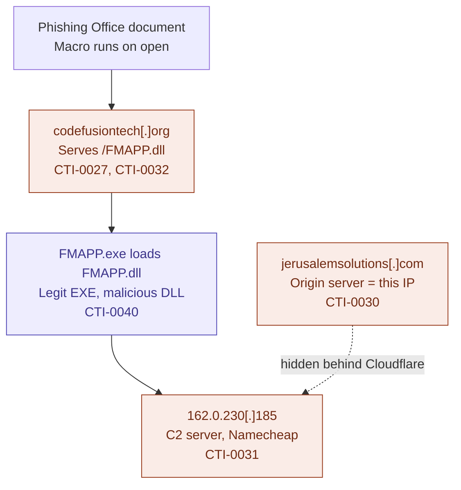

# MuddyWater – Operation Olalampo: FMAPP sideloading chain

Built from independently validated IOCs (IDs refer to the register and validation matrix). All indicators defanged.

## Evidence for each link

| Link | Evidence | Source |
|---|---|---|
| Document → codefusiontech[.]org | Office droppers listed as communicating files of the domain | VirusTotal (Relations) |
| codefusiontech[.]org → FMAPP.dll | URL `hxxp://codefusiontech[.]org/FMAPP.dll` observed 17 May 2026 | AlienVault OTX (Associated URLs) |
| FMAPP.exe → FMAPP.dll | Legitimate Fortemedia binary sideloads malicious DLL | Group-IB Operation Olalampo |
| FMAPP.dll → 162.0.230[.]185 | DLL contacts the IP (SHA-256 3fa148e2…68af) | VirusTotal (Relations) |
| jerusalemsolutions[.]com ↔ 162.0.230[.]185 | TLS certificates for the domain seen on the IP (Dec 2025 – Feb 2026); domain fronted by Cloudflare | VirusTotal (Historical SSL certificates) |

## Notes

- The document → FMAPP step reflects the campaign as described by Group-IB; Group-IB also logged operators launching FMAPP.exe via PowerShell commands sent over Telegram.
- Do not block FMAPP.exe by hash – it is a legitimate signed binary. Detect FMAPP.exe loading FMAPP.dll from a non-standard path.
