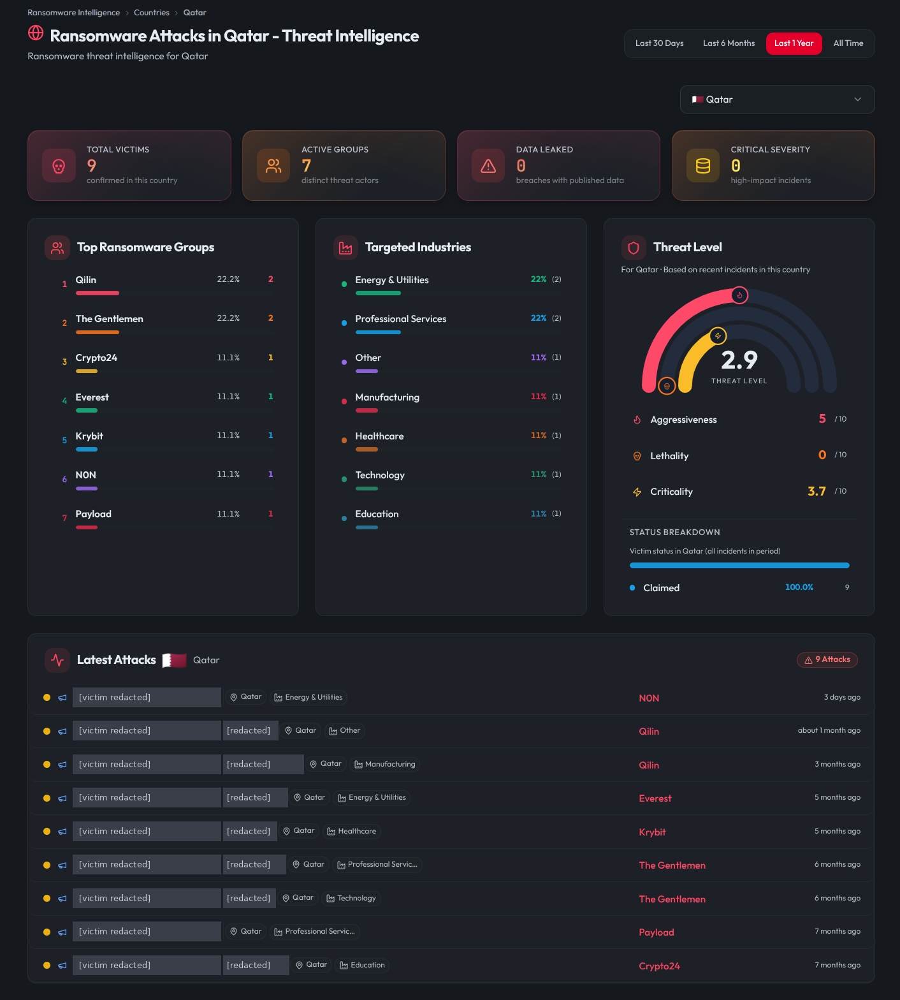

# Validation Matrix

One row per indicator in the public register. **Evidence** links to the screenshots captured during validation (file names are `Screenshot_From_<date>_<time>.png`; the link text shows date and time). Indicators marked *Text check* were validated in bulk or from vendor reporting without a screenshot.

Validation criteria and confidence tiers are defined in [METHODOLOGY.md](../METHODOLOGY.md). Full values for every indicator are in [`iocs/iocs.csv`](../iocs/iocs.csv).

*PIR 1 context: SOCRadar Ransomware Intelligence, Qatar, last 12 months, captured 21 November 2026. Victim names and domains redacted.*

## Payload ransomware

| ID | Type | Indicator | Confidence | Validation summary | Evidence |
|---|---|---|---|---|---|
| CTI-0001 | File Hash (SHA-256) | `1ca67af9…12ffb71f` | High | Three sources: Nopal/Derp.ca, MalwareBazaar signature Payload, VT 58/71 named babuk_payload_win; sandbox shows vssadmin shadow deletion, mutex and payload.log. | [2026-11-21_20-52-53](screenshots/Screenshot_From_2026-11-21_20-52-53.png) [2026-11-21_20-56-35](screenshots/Screenshot_From_2026-11-21_20-56-35.png) [2026-11-21_20-52-17](screenshots/Screenshot_From_2026-11-21_20-52-17.png) [2026-11-21_20-59-55](screenshots/Screenshot_From_2026-11-21_20-59-55.png) [2026-11-21_21-02-28](screenshots/Screenshot_From_2026-11-21_21-02-28.png) [2026-11-21_21-12-57](screenshots/Screenshot_From_2026-11-21_21-12-57.png) |
| CTI-0002 | Mutex | `MakeAmericaGreatAgain` | High | Listed by Nopal; created by validated sample in multiple VT sandboxes (\Sessions\1\BaseNamedObjects). Not logged by Defender, so YARA/live response only. | [2026-11-21_21-11-02](screenshots/Screenshot_From_2026-11-21_21-11-02.png) |
| CTI-0003 | File Path | `C:\payload.log` | High | Listed by Nopal; VT sandbox shows the --background child process writing C:\payload.log, linking log, relaunch and mutex. | [2026-11-21_21-16-46](screenshots/Screenshot_From_2026-11-21_21-16-46.png) |

## The Gentlemen ransomware

| ID | Type | Indicator | Confidence | Validation summary | Evidence |
|---|---|---|---|---|---|
| CTI-0004 | File Hash (SHA-256) | `1334f018…2334436f` | High | Acronis IOC; VT 56/71; Microsoft, ESET, Fortinet, Elastic, Sophos label Gentlemen. Minority BlackByte labels likely signature overlap. Password-gated sandbox run. | [2026-11-21_23-19-33](screenshots/Screenshot_From_2026-11-21_23-19-33.png) [2026-11-21_23-21-13](screenshots/Screenshot_From_2026-11-21_23-21-13.png) [2026-11-21_23-22-35](screenshots/Screenshot_From_2026-11-21_23-22-35.png) [2026-11-21_23-23-10](screenshots/Screenshot_From_2026-11-21_23-23-10.png) [2026-11-21_23-23-41](screenshots/Screenshot_From_2026-11-21_23-23-41.png) [2026-11-21_23-30-23](screenshots/Screenshot_From_2026-11-21_23-30-23.png) |
| CTI-0005 | File Hash (SHA-256) | `3c2466d8…622f51f3` | High | Acronis IOC; VT 56/71; near-unanimous Gentlemen labels incl. vendors that said BlackByte for G1; Trellix label contains MD5 prefix. | [2026-11-21_23-32-58](screenshots/Screenshot_From_2026-11-21_23-32-58.png) [2026-11-21_23-33-30](screenshots/Screenshot_From_2026-11-21_23-33-30.png) [2026-11-21_23-35-12](screenshots/Screenshot_From_2026-11-21_23-35-12.png) [2026-11-21_23-35-26](screenshots/Screenshot_From_2026-11-21_23-35-26.png) |
| CTI-0006 | File Hash (SHA-256) | `586459f1…20598869` | Medium-High | Acronis IOC; present on VT; ESET labels WinGo/Filecoder.Gentlemen.D. Bulk check against one vendor only, so corroborated rather than fully validated. | Text check (see notes) |
| CTI-0007 | File Hash (SHA-256) | `5206a05e…4694c2b9` | Medium-High | Acronis IOC; present on VT; ESET labels WinGo/Filecoder.Gentlemen.D. Bulk check against one vendor only, so corroborated rather than fully validated. | Text check (see notes) |
| CTI-0008 | File Hash (SHA-256) | `228fc86a…103bbec1` | Medium-High | Acronis IOC; present on VT; ESET labels WinGo/Filecoder.Gentlemen.D. Bulk check against one vendor only, so corroborated rather than fully validated. | Text check (see notes) |
| CTI-0009 | File Hash (SHA-256) | `9c6f6c0d…1e13cd09` | Medium-High | Acronis IOC; present on VT; ESET labels WinGo/Filecoder.Gentlemen.D. Bulk check against one vendor only, so corroborated rather than fully validated. | Text check (see notes) |
| CTI-0010 | File Hash (SHA-256) | `dce2e5cc…a77a1c70` | Medium-High | Acronis IOC; present on VT; ESET labels WinGo/Filecoder.Gentlemen.D. Bulk check against one vendor only, so corroborated rather than fully validated. | Text check (see notes) |
| CTI-0011 | File Hash (SHA-256) | `7eb2fd5e…c0d1af75` | Medium-High | Acronis IOC; present on VT; ESET labels WinGo/Filecoder.Gentlemen.D. Bulk check against one vendor only, so corroborated rather than fully validated. | Text check (see notes) |
| CTI-0012 | File Hash (SHA-256) | `403187f0…ac74b313` | Medium-High | Acronis IOC; present on VT; ESET labels WinGo/Filecoder.Gentlemen.D. Bulk check against one vendor only, so corroborated rather than fully validated. | Text check (see notes) |
| CTI-0013 | File Hash (SHA-256) | `363a435e…e7525d02` | Medium-High | Acronis IOC; present on VT; ESET labels WinGo/Filecoder.Gentlemen.D. Bulk check against one vendor only, so corroborated rather than fully validated. | Text check (see notes) |
| CTI-0014 | File Hash (SHA-256) | `cd66fb94…d6501523` | Medium-High | Acronis IOC; present on VT; ESET labels WinGo/Filecoder.Gentlemen.D. Bulk check against one vendor only, so corroborated rather than fully validated. | Text check (see notes) |
| CTI-0015 | File Hash (SHA-256) | `7d90023d…be8be60c` | Medium-High | Acronis IOC; present on VT; ESET labels WinGo/Filecoder.Gentlemen.D. Bulk check against one vendor only, so corroborated rather than fully validated. | Text check (see notes) |
| CTI-0016 | File Hash (SHA-256) | `7284d45b…fc8b3bff` | Medium-High | Acronis IOC; present on VT; ESET labels WinGo/Filecoder.Gentlemen.D. Bulk check against one vendor only, so corroborated rather than fully validated. | Text check (see notes) |
| CTI-0017 | File Hash (SHA-256) | `bd5950d4…b19c48dc` | Medium-High | Acronis IOC; present on VT; ESET labels WinGo/Filecoder.Gentlemen.D. Bulk check against one vendor only, so corroborated rather than fully validated. | Text check (see notes) |
| CTI-0018 | File Hash (SHA-256) | `4de88220…b7a82b8c` | Medium-High | Acronis IOC; present on VT; ESET labels WinGo/Filecoder.Gentlemen.D. Bulk check against one vendor only, so corroborated rather than fully validated. | Text check (see notes) |
| CTI-0019 | File Hash (SHA-256) | `afc30b1a…a4ee73fa` | Medium-High | Acronis IOC; present on VT; ESET labels WinGo/Filecoder.Gentlemen.D. Bulk check against one vendor only, so corroborated rather than fully validated. | Text check (see notes) |
| CTI-0020 | File Hash (SHA-256) | `f483faa2…824c9d09` | Medium-High | Acronis IOC; present on VT; ESET labels WinGo/Filecoder.Gentlemen.D. Bulk check against one vendor only, so corroborated rather than fully validated. | Text check (see notes) |
| CTI-0021 | File Hash (SHA-256) | `6a70824f…58b82b6b` | Medium-High | Acronis IOC; present on VT; ESET labels WinGo/Filecoder.Gentlemen.D. Bulk check against one vendor only, so corroborated rather than fully validated. | Text check (see notes) |
| CTI-0022 | File Hash (SHA-256) | `143af42b…1b5b0676` | Low | Reported, unverified: matches Acronis exactly but absent from VirusTotal, LOLDrivers and public web. Single source; samples from incident response. | [2026-11-21_23-02-59](screenshots/Screenshot_From_2026-11-21_23-02-59.png) |
| CTI-0023 | File Hash (SHA-256) | `a1500204…5e8cda81` | Low | Reported, unverified: matches Acronis exactly but absent from VirusTotal, LOLDrivers and public web. Single source; samples from incident response. | [2026-11-21_23-02-59](screenshots/Screenshot_From_2026-11-21_23-02-59.png) |
| CTI-0024 | File Hash (SHA-256) | `a974a9f0…62c56716` | Low | Reported, unverified: matches Acronis exactly but absent from VirusTotal, LOLDrivers and public web. Single source; samples from incident response. | [2026-11-21_23-02-59](screenshots/Screenshot_From_2026-11-21_23-02-59.png) |
| CTI-0025 | File Hash (SHA-256) | `dfdc8313…ba10defb` | Low | Reported, unverified: matches Acronis exactly but absent from VirusTotal, LOLDrivers and public web. Single source; samples from incident response. | [2026-11-21_23-02-59](screenshots/Screenshot_From_2026-11-21_23-02-59.png) |
| CTI-0026 | Scheduled Task | `gentlemen_system` | Medium | Reported by vendor research; not observed in our sandbox review because samples are password-gated. Highly specific name, negligible false-positive risk. | Text check (see notes) |

## MuddyWater — Operation Olalampo

| ID | Type | Indicator | Confidence | Validation summary | Evidence |
|---|---|---|---|---|---|
| CTI-0027 | Domain | `codefusiontech[.]org` | High | HTTP_VIP C2 per Group-IB; VT 17/92; OTX 17 pulses, Quad9 blocked; 29 malicious files contact it; certificate renewed October 2026 – active. | [2026-11-22_01-06-04](screenshots/Screenshot_From_2026-11-22_01-06-04.png) [2026-11-22_01-07-08](screenshots/Screenshot_From_2026-11-22_01-07-08.png) [2026-11-22_01-08-04](screenshots/Screenshot_From_2026-11-22_01-08-04.png) [2026-11-22_01-09-50](screenshots/Screenshot_From_2026-11-22_01-09-50.png) [2026-11-22_01-14-30](screenshots/Screenshot_From_2026-11-22_01-14-30.png) [2026-11-22_01-14-48](screenshots/Screenshot_From_2026-11-22_01-14-48.png) |
| CTI-0028 | Domain | `promoverse[.]org` | High | GhostFetch C2 per Group-IB; VT 17/92; OTX 9 pulses; contacted by validated burn.exe; certificate renewed October 2026 – active. | [2026-11-22_01-19-13](screenshots/Screenshot_From_2026-11-22_01-19-13.png) [2026-11-22_01-19-44](screenshots/Screenshot_From_2026-11-22_01-19-44.png) [2026-11-22_01-20-02](screenshots/Screenshot_From_2026-11-22_01-20-02.png) [2026-11-22_01-21-00](screenshots/Screenshot_From_2026-11-22_01-21-00.png) [2026-11-22_01-21-48](screenshots/Screenshot_From_2026-11-22_01-21-48.png) |
| CTI-0029 | Domain | `miniquest[.]org` | High | HTTP_VIP C2 per Group-IB; VT 16/92; OTX 14 pulses. WHOIS clientHold and NXDOMAIN since 27 Feb 2026 – suspended, historical only. | [2026-11-22_01-25-49](screenshots/Screenshot_From_2026-11-22_01-25-49.png) [2026-11-22_01-26-11](screenshots/Screenshot_From_2026-11-22_01-26-11.png) [2026-11-22_01-26-38](screenshots/Screenshot_From_2026-11-22_01-26-38.png) [2026-11-22_01-27-09](screenshots/Screenshot_From_2026-11-22_01-27-09.png) [2026-11-22_01-27-27](screenshots/Screenshot_From_2026-11-22_01-27-27.png) [2026-11-22_01-27-57](screenshots/Screenshot_From_2026-11-22_01-27-57.png) |
| CTI-0030 | Domain | `jerusalemsolutions[.]com` | High | OTX tags 'operation olalampo' and 'http_vip'; VT 17/92; not a real business. Expired 28 Oct 2026, now parked – historical only. | [2026-11-22_01-34-50](screenshots/Screenshot_From_2026-11-22_01-34-50.png) [2026-11-22_01-35-08](screenshots/Screenshot_From_2026-11-22_01-35-08.png) [2026-11-22_01-35-43](screenshots/Screenshot_From_2026-11-22_01-35-43.png) [2026-11-22_01-36-09](screenshots/Screenshot_From_2026-11-22_01-36-09.png) [2026-11-22_01-37-25](screenshots/Screenshot_From_2026-11-22_01-37-25.png) [2026-11-22_01-37-46](screenshots/Screenshot_From_2026-11-22_01-37-46.png) |
| CTI-0031 | IPv4 | `162.0.230[.]185` | High | Origin server for jerusalemsolutions (TLS certificates); contacted by validated FMAPP.dll; OTX 21 pulses. Namecheap hosting IP – may be reassigned. | [2026-11-22_01-44-28](screenshots/Screenshot_From_2026-11-22_01-44-28.png) [2026-11-22_01-45-04](screenshots/Screenshot_From_2026-11-22_01-45-04.png) [2026-11-22_01-45-35](screenshots/Screenshot_From_2026-11-22_01-45-35.png) [2026-11-22_01-46-07](screenshots/Screenshot_From_2026-11-22_01-46-07.png) [2026-11-22_01-46-31](screenshots/Screenshot_From_2026-11-22_01-46-31.png) [2026-11-22_01-46-59](screenshots/Screenshot_From_2026-11-22_01-46-59.png) [2026-11-22_01-53-26](screenshots/Screenshot_From_2026-11-22_01-53-26.png) |
| CTI-0032 | URL | `hxxp://codefusiontech[.]org/FMAPP.dll` | High | OTX associated URL on validated C2 domain; serves the validated malicious FMAPP.dll used for sideloading. | [2026-11-22_01-14-48](screenshots/Screenshot_From_2026-11-22_01-14-48.png) |
| CTI-0033 | URL | `hxxps://codefusiontech[.]org/postinfo` | High | Contacted by validated HTTP_VIP sample pic.log (VT 19/92). First Seen = earliest contacting sample. | [2026-11-22_13-30-42](screenshots/Screenshot_From_2026-11-22_13-30-42.png) |
| CTI-0034 | URL | `hxxps://codefusiontech[.]org/content?id=141` | High | Contacted by validated HTTP_VIP sample pic.log (VT 18/92). First Seen = earliest contacting sample. | [2026-11-22_13-30-42](screenshots/Screenshot_From_2026-11-22_13-30-42.png) |
| CTI-0035 | URL | `hxxps://promoverse[.]org/api/debut` | High | Contacted by validated GhostFetch burn.exe (VT 20/92). First Seen = earliest contacting sample. | [2026-11-22_13-11-34](screenshots/Screenshot_From_2026-11-22_13-11-34.png) |
| CTI-0036 | URL | `hxxps://promoverse[.]org/api/authentification/connexion` | High | Contacted by validated GhostFetch sibling build (VT 20/92). French C2 path. First Seen = earliest contacting sample. | [2026-11-22_13-06-52](screenshots/Screenshot_From_2026-11-22_13-06-52.png) |
| CTI-0037 | URL | `hxxps://promoverse[.]org/api/accueil/etat` | High | Contacted by validated GhostFetch sibling build (VT 20/92). French C2 path. First Seen = earliest contacting sample. | [2026-11-22_13-06-52](screenshots/Screenshot_From_2026-11-22_13-06-52.png) |
| CTI-0038 | File Hash (SHA-256) | `8d2227f2…df80548b` | High | SHA-1 matches Group-IB row 38; 52/68 on VT; Microsoft and ESET name MuddyWater; contacts validated C2 promoverse[.]org; first seen January 2026. | [2026-11-22_12-53-38](screenshots/Screenshot_From_2026-11-22_12-53-38.png) [2026-11-22_12-54-37](screenshots/Screenshot_From_2026-11-22_12-54-37.png) [2026-11-22_13-11-34](screenshots/Screenshot_From_2026-11-22_13-11-34.png) [2026-11-22_12-56-18](screenshots/Screenshot_From_2026-11-22_12-56-18.png) |
| CTI-0039 | File Hash (SHA-256) | `3a19c19d…947bd819` | Medium-High | Group-IB row 40; VT 52/70; contacts validated promoverse[.]org; build matches burn.exe. Only Trend Micro names MuddyWater; Microsoft/Symantec say Cobalt Strike. | [2026-11-22_13-05-44](screenshots/Screenshot_From_2026-11-22_13-05-44.png) [2026-11-22_13-06-25](screenshots/Screenshot_From_2026-11-22_13-06-25.png) [2026-11-22_13-06-52](screenshots/Screenshot_From_2026-11-22_13-06-52.png) [2026-11-22_13-10-53](screenshots/Screenshot_From_2026-11-22_13-10-53.png) |
| CTI-0040 | File Hash (SHA-256) | `3fa148e2…2e4e68af` | High | SHA-1 matches Group-IB row 14; VT 52/71; Microsoft labels MuddyWater.DA!MTB (same as burn.exe); contacts validated C2 162.0.230[.]185. | [2026-11-22_13-18-37](screenshots/Screenshot_From_2026-11-22_13-18-37.png) [2026-11-22_13-19-20](screenshots/Screenshot_From_2026-11-22_13-19-20.png) [2026-11-22_13-19-50](screenshots/Screenshot_From_2026-11-22_13-19-50.png) [2026-11-22_13-20-32](screenshots/Screenshot_From_2026-11-22_13-20-32.png) |
| CTI-0041 | File Hash (SHA-256) | `1b9e6fe4…68b0009a` | High | SHA-1 matches Group-IB row 33; VT 53/71; Trend Micro names HTTPVIP, Microsoft MuddyWater; contacts validated C2 codefusiontech[.]org. | [2026-11-22_13-32-37](screenshots/Screenshot_From_2026-11-22_13-32-37.png) [2026-11-22_13-29-42](screenshots/Screenshot_From_2026-11-22_13-29-42.png) [2026-11-22_13-30-42](screenshots/Screenshot_From_2026-11-22_13-30-42.png) [2026-11-22_13-31-22](screenshots/Screenshot_From_2026-11-22_13-31-22.png) |
| CTI-0042 | File Hash (SHA-1) | `34413068…200e9152` | Medium-High | Group-IB IOC; present on VT with at least one vendor naming MuddyWater. Bulk check, not fully validated. | Text check (see notes) |
| CTI-0043 | File Hash (SHA-1) | `9ca11fcb…7bd0fb8e` | Medium-High | Group-IB IOC; present on VT with at least one vendor naming MuddyWater. Bulk check, not fully validated. | Text check (see notes) |
| CTI-0044 | File Hash (SHA-1) | `2f516608…9a6db444` | Medium-High | Group-IB IOC; present on VT with at least one vendor naming MuddyWater. Bulk check, not fully validated. | Text check (see notes) |
| CTI-0045 | File Hash (SHA-1) | `d0d7d0c8…994b64b0` | Medium-High | Group-IB IOC; present on VT with at least one vendor naming MuddyWater. Bulk check, not fully validated. | Text check (see notes) |
| CTI-0046 | File Hash (SHA-1) | `f449b958…6c69ecb4` | Medium-High | Group-IB IOC; present on VT with at least one vendor naming MuddyWater. Bulk check, not fully validated. | Text check (see notes) |
| CTI-0047 | File Hash (SHA-1) | `0365daf8…288ef2f9` | Medium-High | Group-IB IOC; present on VT with at least one vendor naming MuddyWater. Bulk check, not fully validated. | Text check (see notes) |
| CTI-0048 | File Hash (SHA-1) | `777040be…6beae064` | Medium-High | Group-IB IOC; present on VT with at least one vendor naming MuddyWater. Bulk check, not fully validated. | Text check (see notes) |
| CTI-0049 | File Hash (SHA-1) | `f5a129ba…548aa949` | Medium-High | Group-IB IOC; present on VT with at least one vendor naming MuddyWater. Bulk check, not fully validated. | Text check (see notes) |
| CTI-0050 | File Hash (SHA-1) | `f77499a8…3d5f0f81` | Medium-High | Group-IB IOC; present on VT with at least one vendor naming MuddyWater. Bulk check, not fully validated. | Text check (see notes) |
| CTI-0051 | File Hash (SHA-1) | `dc785be0…134a02b6` | Medium-High | Group-IB IOC; present on VT with at least one vendor naming MuddyWater. Bulk check, not fully validated. | Text check (see notes) |
| CTI-0052 | File Hash (SHA-1) | `e79ccc3f…6f574e64` | Medium-High | Group-IB IOC; present on VT with at least one vendor naming MuddyWater. Bulk check, not fully validated. | Text check (see notes) |
| CTI-0053 | File Hash (SHA-1) | `975c763e…f0626c5b` | Medium-High | Group-IB IOC; present on VT with at least one vendor naming MuddyWater. Bulk check, not fully validated. | Text check (see notes) |
| CTI-0054 | File Hash (SHA-1) | `56380a65…1f0fc324` | Medium-High | Group-IB IOC; present on VT with at least one vendor naming MuddyWater. Bulk check, not fully validated. | Text check (see notes) |
| CTI-0055 | File Hash (SHA-1) | `9defffba…17d29077` | Medium-High | Group-IB IOC; present on VT with at least one vendor naming MuddyWater. Bulk check, not fully validated. | Text check (see notes) |
| CTI-0056 | File Hash (SHA-1) | `0588cf26…d29f135c` | Medium-High | Group-IB IOC; present on VT with at least one vendor naming MuddyWater. Bulk check, not fully validated. | Text check (see notes) |
| CTI-0057 | File Hash (SHA-1) | `06f3b55f…7ff8ed04` | Medium | Group-IB IOC; flagged malicious on VT but no vendor names MuddyWater. Attribution rests on Group-IB only. | Text check (see notes) |
| CTI-0058 | File Hash (SHA-1) | `392a3671…8fbe2f72` | Medium | Group-IB IOC; flagged malicious on VT but no vendor names MuddyWater. Attribution rests on Group-IB only. | Text check (see notes) |
| CTI-0059 | File Hash (SHA-1) | `2993b0ab…e34ea4fb` | Medium | Group-IB IOC; flagged malicious on VT but no vendor names MuddyWater. Attribution rests on Group-IB only. | Text check (see notes) |
| CTI-0060 | File Hash (SHA-1) | `efb18cf7…42815f94` | Medium | Group-IB IOC; flagged malicious on VT but no vendor names MuddyWater. Attribution rests on Group-IB only. | Text check (see notes) |
| CTI-0061 | File Hash (SHA-1) | `7d3757d5…b9301e2d` | Medium | Group-IB IOC; flagged malicious on VT but no vendor names MuddyWater. Attribution rests on Group-IB only. | Text check (see notes) |
| CTI-0062 | File Hash (SHA-1) | `e3cc95ca…9ce04e8e` | Medium | Group-IB IOC; flagged malicious on VT but no vendor names MuddyWater. Attribution rests on Group-IB only. | Text check (see notes) |
| CTI-0063 | File Hash (SHA-1) | `ceb9b7df…f2dcefd1` | Medium | Group-IB IOC; flagged malicious on VT but no vendor names MuddyWater. Attribution rests on Group-IB only. | Text check (see notes) |
| CTI-0064 | File Hash (SHA-1) | `88cb6169…8e698028` | Medium | Group-IB IOC; flagged malicious on VT but no vendor names MuddyWater. Attribution rests on Group-IB only. | Text check (see notes) |
| CTI-0065 | File Hash (SHA-1) | `5c150029…d25ab69b` | Medium | Group-IB IOC; flagged malicious on VT but no vendor names MuddyWater. Attribution rests on Group-IB only. | Text check (see notes) |
| CTI-0066 | File Hash (SHA-1) | `8c592d9a…2c526670` | Low | Reported, unverified: listed by Group-IB but not found on VirusTotal. Single source. | Text check (see notes) |
| CTI-0067 | File Hash (SHA-1) | `f779a3b1…3af7e26c` | Low | Reported, unverified: listed by Group-IB but not found on VirusTotal. Single source. | Text check (see notes) |
| CTI-0068 | File Hash (SHA-1) | `d3fa50a9…62718a5f` | Low | Reported, unverified: listed by Group-IB but not found on VirusTotal. Single source. | Text check (see notes) |
| CTI-0069 | File Path | `%LOCALAPPDATA%\Microsoft\Windows\BurnUtill\burn.exe` | High | Written and executed by validated burn.exe in VT sandbox; Group-IB says GhostFetch persists as burn.exe. Misspelt 'BurnUtill' folder is distinctive. | [2026-11-22_12-56-18](screenshots/Screenshot_From_2026-11-22_12-56-18.png) |
| CTI-0070 | File Path | `%USERPROFILE%\AppData\SystemApps\` | Medium | Folder written by validated pic.log in VT sandbox. SysTemp.exe filename comes from VT AI insights only – unverified. | [2026-11-22_13-31-22](screenshots/Screenshot_From_2026-11-22_13-31-22.png) |
| CTI-0071 | Service Name | `MicrosoftVersionUpdater` | Medium | Reported by Group-IB as GhostBackDoor service when run with admin rights; not observed in our sandbox review. No legitimate Microsoft service of this name. | Text check (see notes) |
| CTI-0072 | Scheduled Task | `DailyUpdate (running novaservice.exe)` | Medium | Reported by Group-IB from operator Telegram logs; not observed in our review. Rule requires both task name and novaservice to limit false positives. | Text check (see notes) |

## Pivot checked and rejected

| Lead | Result | Evidence |
|---|---|---|
| `brendysubs[.]com` (TLS certificates on the same server as CTI-0031) | 0/92 detections, different registrar, registered before MuddyWater used the IP — most likely an unrelated tenant. Not an indicator. | [2026-11-22_01-53-26](screenshots/Screenshot_From_2026-11-22_01-53-26.png) |
